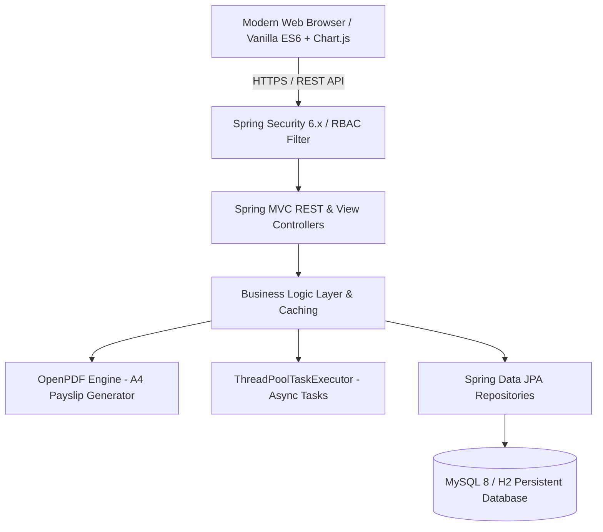

# 🌟 HRMS Portal — Enterprise Full-Stack Edition

A portfolio-ready, enterprise-grade **Human Resource Management System (HRMS)** built with **Java 17, Spring Boot, Spring Security (RBAC), Spring Data JPA, OpenPDF Engine, MySQL 8 / H2, Thymeleaf, and Modern Vanilla CSS3 / ES6+ JavaScript**.

---

## 🚀 Key Highlights & Enterprise Capabilities

- **12 Fully Functional Modules:** Dashboard, Employees, Departments, Attendance, Leave Management, Payroll & Payslips, Announcements, Holiday Calendar, Performance Reviews, User RBAC Management, Compliance Audit Logs, and System Settings.
- **Automated Payroll & Tax Engine:** Batch monthly payroll calculation with statutory deductions (PF, Professional Tax, TDS/Income Tax), status disbursement workflow, and **automated downloadable A4 PDF payslips** via OpenPDF.
- **Executive Analytics:** Interactive visual charts powered by Chart.js, department workforce breakdown, and real-time attendance & leave KPI counters.
- **Enterprise Caching & Async Execution:** In-memory caching (`ConcurrentMapCacheManager`) for low-latency queries and `@EnableAsync` thread pool for background tasks.
- **Global Search Engine:** Instant unified search across Employees, Departments, and Announcements right from the top navigation bar.
- **Containerized Deployment:** Production-ready multi-stage `Dockerfile` and `docker-compose.yml` with MySQL 8 healthchecks.
- **Zero-Setup Local Persistence:** Automatic H2 file-backed persistence or MySQL 8 production database.

---

## 📑 Complete 12-Module Directory

| # | Module | Route | Key Capabilities |
|---|---|---|---|
| 1 | **Dashboard** | `/dashboard` | Executive KPI cards, Chart.js workforce analytics, cultural milestones, announcements, holiday widget |
| 2 | **Employees** | `/employees` | Complete workforce directory, multi-parameter search/filters, full profile drawer, avatar generator |
| 3 | **Departments** | `/departments` | Org structure, department head assignment, headcount stats, safe rename and deletion safeguards |
| 4 | **Attendance** | `/attendance` | Self-service live clock-in / clock-out widget, hours calculator, daily logs, manual adjustments |
| 5 | **Leave Portal** | `/leave` | Multi-type leave requests (Casual, Sick, Annual, Unpaid), leave balance tracker, 1-click approval workflow |
| 6 | **Payroll & Payslips** | `/payroll` | Salary breakdown (Basic, HRA, Allowance), statutory deductions (PF, PT, TDS), **Downloadable PDF payslips**, batch run |
| 7 | **Announcements** | `/announcements` | Company-wide news broadcast, priority levels (Urgent, High, Normal, Low), target audience filtering |
| 8 | **Holiday Calendar** | `/holidays` | Company holidays calendar, holiday categories (National, Gazetted, Optional), live next holiday countdown |
| 9 | **Performance Reviews** | `/performance-reviews` | 360° appraisal scorecard, 5-star ratings, review cycles (Q1-Q4 / Annual), employee acknowledgment |
| 10 | **User Management** | `/user-management` | RBAC user administration, credential management, instant password reset modal, account status toggle |
| 11 | **Compliance & Audit** | `/audit-log` | Immutable security audit trail, user action tracking, IP address capture, date and action filters |
| 12 | **System Settings** | `/settings` | User profile info, security password change form, live JVM memory & runtime diagnostics |

---

## 🔑 Demo Access & Roles

The system is pre-seeded with 3 operational roles:

| Role | Username | Password | Permitted Actions |
|---|---|---|---|
| **Admin** | `admin` | `Admin@123` | Full access across all 12 modules: User accounts, batch payroll, settings, approvals |
| **HR Specialist** | `hr` | `Hr@12345` | Employee onboarding, attendance corrections, leave approvals, announcements, holiday management |
| **Employee** | `employee` | `Employee@123` | Self-service profile, clock in/out, submit leave requests, view & download PDF payslips |

---

## 🛠️ Architecture & Tech Stack



- **Backend:** Java 17, Spring Boot 4.1.1, Spring Security, Spring Data JPA, Spring Cache, Spring Async
- **PDF Generation:** LibrePDF / OpenPDF 1.3.40 (Vector styling, custom headers, A4 table layouts)
- **Frontend:** Semantic HTML5, Vanilla CSS3 (Custom design tokens, Dark Mode support), ES6+ JavaScript, Chart.js
- **Persistence:** MySQL 8+ or local embedded H2 database (`./data/hrms_db`)
- **Containerization:** Multi-stage Docker build with Eclipse Temurin 17 Alpine

---

## 🚀 Running the Application

### Option 1: Zero-Configuration Local Start (H2 Profile)

No database installation required! Run the included PowerShell or CMD launch scripts:

**PowerShell:**
```powershell
.\run-hrms-h2.ps1
```

**Windows Command Prompt:**
```cmd
run-hrms-h2.bat
```

Open your browser at: **`http://localhost:8080/login`**

---

### Option 2: Running with Docker Compose (Recommended for Production)

Run both MySQL 8 and the HRMS application in orchestrated containers:

```bash
docker compose up -d --build
```

View application logs:
```bash
docker compose logs -f hrms-app
```

Stop containers:
```bash
docker compose down
```

---

### Option 3: Local MySQL Database

1. Create the MySQL database:
```sql
CREATE DATABASE IF NOT EXISTS hrms_db
  CHARACTER SET utf8mb4
  COLLATE utf8mb4_unicode_ci;
```

2. Run with default profile:
```powershell
.\run-hrms.ps1
```

---

## 🔌 Core REST API Endpoints

### 💳 Payroll & Payslips
| Method | Endpoint | Description | Access |
|---|---|---|---|
| `GET` | `/api/payroll` | List all historical payslips | Admin, HR |
| `GET` | `/api/payroll/employee/{id}` | Payslips for a specific employee | Admin, HR, Employee (self) |
| `POST` | `/api/payroll/run?year=2026&month=10` | Run batch monthly payroll | Admin |
| `GET` | `/api/payroll/payslips/{id}/pdf` | **Download branded PDF payslip** | Admin, HR, Employee (owner) |
| `POST` | `/api/payroll/payslips/{id}/pay` | Disburse payslip payment | Admin |

### 👥 Employees & Departments
| Method | Endpoint | Description | Access |
|---|---|---|---|
| `GET` | `/api/employees` | Search and filter employee directory | Authenticated |
| `GET` | `/api/employees/{id}` | Get employee profile details | Authenticated |
| `POST` | `/api/employees` | Create a new employee | Admin, HR |
| `PUT` | `/api/employees/{id}` | Update existing employee | Admin, HR |
| `DELETE` | `/api/employees/{id}` | Delete employee | Admin |
| `GET` | `/api/departments` | List all departments | Authenticated |

### ⏱️ Attendance & Leaves
| Method | Endpoint | Description | Access |
|---|---|---|---|
| `GET` | `/api/attendance/today` | Current day clock status for user | Authenticated |
| `POST` | `/api/attendance/clock-in` | Record employee clock in | Authenticated |
| `POST` | `/api/attendance/clock-out` | Record employee clock out | Authenticated |
| `POST` | `/api/leaves/apply` | Submit leave request | Authenticated |
| `POST` | `/api/leaves/{id}/approve` | Approve leave application | Admin, HR |
| `POST` | `/api/leaves/{id}/reject` | Reject leave application | Admin, HR |

### 📢 Announcements & Holidays
| Method | Endpoint | Description | Access |
|---|---|---|---|
| `GET` | `/api/announcements` | Active company announcements | Authenticated |
| `POST` | `/api/announcements` | Publish announcement | Admin, HR |
| `GET` | `/api/holidays` | Company holiday schedule | Authenticated |
| `POST` | `/api/holidays` | Add official holiday | Admin, HR |

### 🔍 Unified Search & Diagnostics
| Method | Endpoint | Description | Access |
|---|---|---|---|
| `GET` | `/api/search?q={keyword}` | Unified search across employees, depts, announcements | Authenticated |
| `GET` | `/api/reports/summary` | Real-time workforce metrics | Admin, HR |
| `GET` | `/api/me` | Current authenticated user session & role | Authenticated |

---

## 🧪 Testing & Quality Assurance

To execute the test suite:

```powershell
$env:JAVA_HOME = 'C:\PROGRA~1\Java\jdk-17'
mvn clean test
```

All 8 automated integration and unit test suites validate:
- User authentication and role assignment
- Cascade safety on department updates and employee deletions
- Payroll calculations and database constraints
- Attendance clock-in / clock-out calculations
- Leave request lifecycle and status updates

---

## 📄 License
This project is open-source and available under the **MIT License**.
